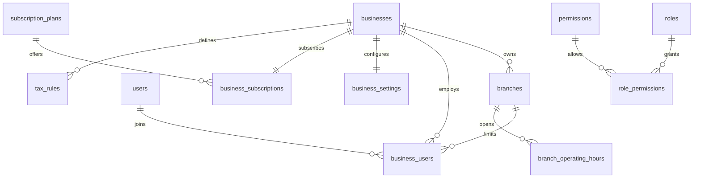
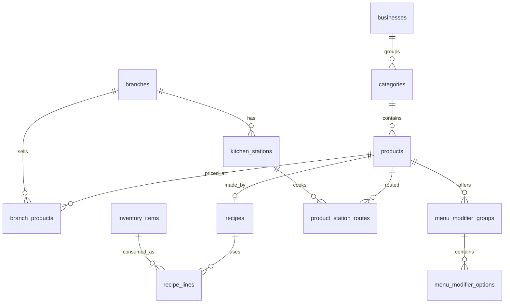
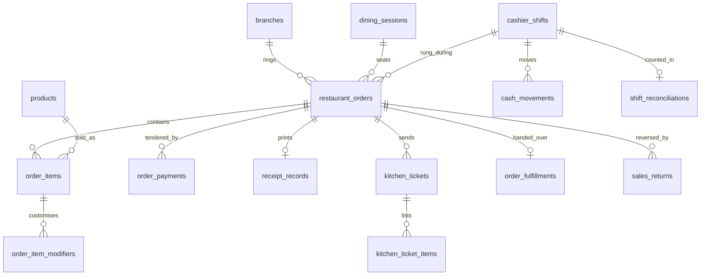
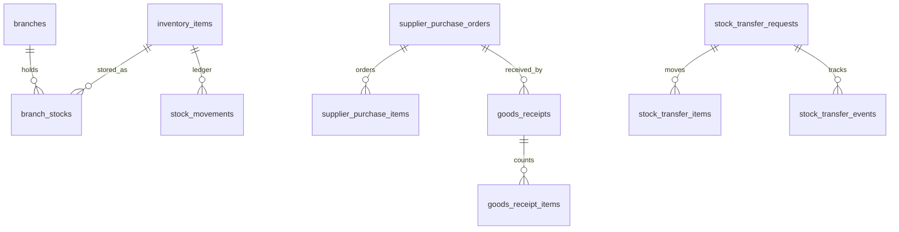

# Major relationships

There are 65 application tables. The diagrams below show the relationships a student is expected to explain. Column lists are in `DATABASE_DICTIONARY.md`.

## Tenant and access

## Menu, recipe and kitchen

## Orders, kitchen, payment and cash

## Stock

A finished plate is a `products` row. Flour and chicken are `inventory_items`. `recipe_lines` connects them. Paying an order posts `recipe_consumption` movements once. Repeating the same order reference does not deduct again.

Transfers are allowed only when both branches belong to the transfer's business. The database trigger `trg_pos_transfer_business` enforces that, and the service checks it before writing.
